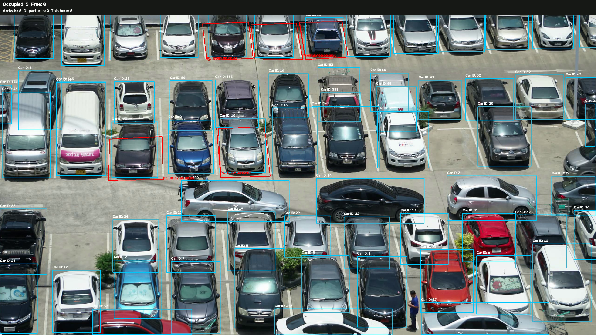

# Smart Parking Management (Junior CV Project)
## Project Demo


## Run the Demo

Place a fixed-camera parking video at `data/parking.mp4`. The saved parking-space coordinates are calibrated for the original demo video.

```powershell
python parking_manager.py --video data/parking.mp4 --config config/parking_spaces.json --model yolo11s.pt --output outputs/improved_run --no-show
```

Results are saved in `outputs/improved_run/`: processed video, parking events CSV, and hourly counts CSV. For a different camera view, configure the parking spaces again using `configure_spaces.py`.
**Stack:** OpenCV, a pretrained Ultralytics YOLO detector and ByteTrack, Pandas.  
**Goal:** Detect cars in a **fixed-camera** parking view, assign vehicles to marked spaces, estimate space-level parking duration and report arrival counts by hour.

## Setup (Windows PowerShell)

```powershell
py -3.11 -m venv .venv
.\.venv\Scripts\Activate.ps1
pip install -r requirements.txt
```

Put your own fixed-camera video at `data/parking.mp4` (do not commit private footage).

```powershell
python configure_spaces.py --video data/parking.mp4
```

- Left-click 3+ corners of a parking space and press **N** to finish it; repeat for other spaces.
- Press **L** and left-click **two points** along the entrance line (optional).
- Press **S** to save `config/spaces.json`.
- Adjust `entry_direction` in JSON if the entrance direction is reversed.

```powershell
python parking_manager.py --video data/parking.mp4 --start-time "2026-11-11 09:00:00"
```

To use a live camera: `python parking_manager.py --video 0`.
For headless processing add `--no-show`.

Outputs:

- `outputs/parking_result.mp4`: boxes, parking space colors, total occupied/free, arrivals and departures
- `outputs/parking_events.csv`: entry, exit, parked and left-space event log; duration in seconds
- `outputs/hourly_count.csv`: arrivals per hour

If an entry line is configured, hourly counts are based on vehicles crossing it. **Without an entry line**, hourly arrivals are based on newly occupied spaces and can double-count a vehicle that moves between spaces.

## Limits & assumptions

- Camera should be static; cars visible enough for the pretrained detector. You manually define polygons on the video.
- Duration means time the same parking **space** stays occupied, not a guaranteed vehicle identity across occlusions or camera restarts.
- There is a 2-second grace period for missed detections, but false positives and ID switches are still possible.
- Video file timestamps are derived from frame number and FPS (and the optional start date); live camera timestamps use wall-clock time. Pre-recorded video does not contain genuine entry dates without external metadata.
- Do not use these counts for enforcement or billing without validation against real footage.
- Ultralytics model weights may download automatically on first run; check its license before commercial redistribution.
